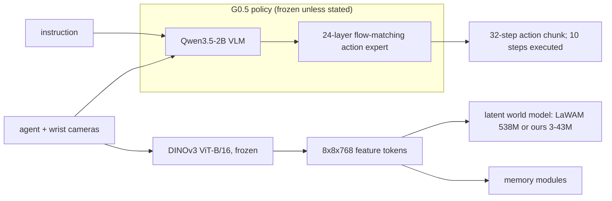
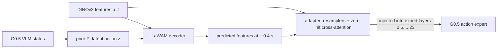
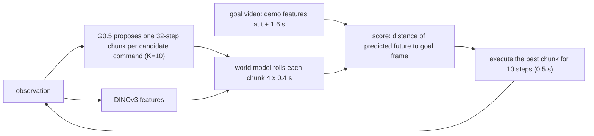
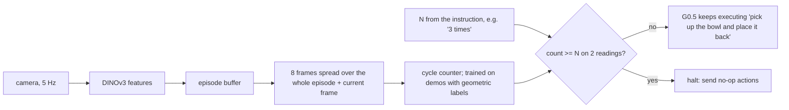

# World models, memory and steerability for a VLA: G0.5 × LaWAM

**Can world models and memory make a strong vision-language-action policy better, and how would that carry over to our own policy and robot?**

*Galaxea G0.5 (flow-matching), LaWAM's pretrained latent world model, our own small JEPA-style world model, and external memory modules. Evaluated in closed loop in the LIBERO simulator, October 2026.*

| Question | Closed-loop answer |
|---|---|
| Can a **small latent world model plan** for a frozen VLA? | **Yes.** Given a goal video and no instruction, our 43M world model chooses among G0.5's proposals: **77% success vs 2% (random) / 7% (no instruction)**, p = 5e-23. |
| Does **memory** help a Markovian VLA? | **Yes, as an external module.** Instruction withdrawn: **40% → 86%**. LIBERO-Mem repetition tasks: **5.8% → 19.2%**, while a no-memory control stays at 4.2%. |
| Can we improve **steerability**? | **Only modestly.** Recovery fine-tuning: **20% → 28%** vs its matched control (p = 0.008), which is back to G0.5's own 29%. A planner cannot add steerability. |
| Does feeding a **pretrained world model's predictions into the policy** help? | **No.** Staged injection *hurts* (−7.5 pts, p = 0.012); joint training is neutral. |

---

## Contents

1. [Literature review](#1-literature-review)
2. [Ideas we chose to explore](#2-ideas-we-chose-to-explore)
3. [Setup](#3-setup)
4. [Experiment plan and what was run](#4-experiment-plan-and-what-was-run)
5. [Results](#5-results)
   - 5.1 [Injecting LaWAM's world model into G0.5](#51-injecting-lawams-world-model-into-g05)
   - 5.2 [Our small JEPA-style world model](#52-our-small-jepa-style-world-model)
   - 5.3 [Planning with the world model, closed loop](#53-planning-with-the-world-model-closed-loop)
   - 5.4 [Steerability](#54-steerability)
   - 5.5 [Memory](#55-memory)
   - 5.6 [What happened with 3D-Mem snapshots](#56-what-happened-with-3d-mem-snapshots)
6. [How this carries over to our policy, our data and the real robot](#6-how-this-carries-over-to-our-policy-our-data-and-the-real-robot)
7. [Limitations](#7-limitations)
8. [Engineering notes and reproducibility](#8-engineering-notes-and-reproducibility)
9. [References](#9-references)

---

## 1. Literature review

| Paper | Core idea | Key evidence | What we took from it |
|---|---|---|---|
| **RoboJEPA** (Zholus et al., 2026) [[1]](#ref1) | Scale a JEPA latent world model on real robot data from 12 embodiments; plan toward a goal image | 22M → 8B parameters. Imagination (rollout) error follows a power law in compute and **predicts planning success**. Zero-shot goal-image planning on real hardware. | Predict in **feature space, not pixels**. Treat small models as one point on a scaling curve. Use **offline rollout quality as a proxy** before robot time. Plan toward goal images. |
| **FLARE** (Zheng et al., CoRL 2025) [[2]](#ref2) | **Implicit** world modelling: align a diffusion-transformer policy's internal features with embeddings of *future* observations, using a few extra tokens | Up to +26% over baselines on two multitask simulation benchmarks (single-arm, humanoid). Can co-train on action-free human video; one-demo generalisation to novel objects. | Future prediction is most useful as a **training signal**, not as an extra input. Our results agree (§5.1). FLARE-style alignment on G0.5 is the natural next variant. |
| **LaWAM** (Chen et al., 2026) [[3]](#ref3) | Train a latent action model in a frozen vision model's feature space (DINOv3). Reuse its decoder as a **latent world model** that predicts future features, and condition the policy on these latent subgoals. | LIBERO 98.6%, RoboTwin 91.2%, real robot. 187 ms per chunk, up to 24× faster than pixel-space world-action models. | The world model and checkpoint (`lawam_pretrain`) we **transplanted into G0.5** (§5.1). Its DINOv3 latent space is also the space our own world model predicts in (§5.2). |
| **3D-Mem** (Yang et al., CVPR 2025) [[4]](#ref4) | Episodic scene memory as a compact set of **multi-view image snapshots** (clusters of co-visible objects) plus frontier snapshots; incremental construction and retrieval | Better exploration and embodied QA on A-EQA, GOAT-Bench and others | **Event-driven snapshot memory** (write when the scene changes; read first + recent) as a compact alternative to storing every frame. Tested inside G0.5 and as an external memory (§5.6). |
| **Pretrained VLAs are surprisingly resistant to forgetting** (Liu et al., ICML 2026) [[5]](#ref5) | Continual learning with large pretrained VLAs (π0, GR00T N1.5) vs small policies trained from scratch | Pretrained VLAs forget far less. **Simple experience replay** with a tiny buffer can give near-zero forgetting. "Forgotten" skills come back quickly with fine-tuning. | Fine-tuning G0.5 for a new ability (steering recovery, LIBERO-Mem) with **a small slice of original data replayed** should keep old skills. We did this (10–50% replay) and saw no significant loss on old behaviour (§5.4). Continual learning itself was not run. |

**Synthesis:**

| Theme | What the literature says | Our bet |
|---|---|---|
| World models | Predicting the future in a frozen foundation-model feature space is cheap and works at scale (RoboJEPA, LaWAM). For policies, prediction may help more as a training signal (FLARE) than as an input. | (a) Test LaWAM's predictions *inside* G0.5. (b) Build a small in-domain world model and use it *next to* G0.5 for planning. |
| Memory | Compact, event-driven episodic memories work for long-horizon agents (3D-Mem). | Strong VLAs like G0.5 are Markovian, so memory should help when the current frame is ambiguous. |
| Fine-tuning | Large pretrained VLAs tolerate fine-tuning with small replay (forgetting paper). | Targeted fine-tunes for steering and memory are low-risk for existing skills. |

---

## 2. Ideas we chose to explore

The supervisor's four directions, and the concrete idea we tested for each:

| Direction | Idea tested | Why it is testable now |
|---|---|---|
| **Generalisation and steerability of low-level policies** | Probe G0.5 with counterfactual commands, mid-task command switches and instruction withdrawal. Fix switching with recovery data. | LIBERO-Goal has 10 tasks in one shared scene, so the instruction is the only thing that differs between tasks. |
| **JEPA-style small latent world models** | (a) Transplant LaWAM's pretrained world model into G0.5. (b) Train our own 3–43M action-conditioned latent world model on DINOv3 features. | LaWAM's checkpoint is public, and LIBERO gives 270k frames with actions. |
| **Memory beyond Markovian VLAs** (plus ICL and continual learning) | (a) Memory adapters inside G0.5 (fixed offsets; 3D-Mem-style snapshots). (b) **External memory modules** that re-issue the task or count progress and stop the robot. (c) The standard non-Markovian benchmark **LIBERO-Mem**. | Withdrawal probes and LIBERO-Mem create situations where the current frame is ambiguous. |
| **Planning or training in a world model** | (a) Train G0.5 with world-model foresight (staged and joint). (b) **Plan at test time**: the world model scores G0.5's candidate action chunks against a goal. | G0.5 proposes 32-step chunks, and the world model can roll them out in milliseconds. |

---

## 3. Setup

**Policy.** Galaxea **G0.5**, the released LIBERO checkpoint `g05-libero` in flow-matching mode: Qwen3.5-2B VLM plus a 24-layer action expert, about 2.9B parameters. It scores **98.9%** on LIBERO. We reproduced 99.2 / 99.8 / 98.2 / 98.4 on Spatial / Object / Goal / Long.

**World models.**
- **LaWAM LaWM** (`jialei02/lawam_pretrain`): DINOv3 ViT-B/16 features, a 32-d latent action, an inverse-dynamics encoder and a forward decoder.
- **Ours:** a transformer that predicts the pooled DINOv3 tokens 0.4 s ahead from the current tokens and an 8-step action chunk. Trained with a 1-step + 2-step rollout loss.

**Benchmarks.**
- **LIBERO** (4 suites, 40 tasks).
- **LIBERO-Goal steering and memory probes:** pairs t ← s = t+3, events at 2 s, 100 paired episodes per cell.
- **LIBERO-Mem** [[6]](#ref6): 10 non-Markovian tasks, 120 demos each; demos 100–119 held out.

**Compute.**
- Shared GPU cluster, 4×H200 allowance. The H200s were fully booked for most of the project.
- To keep going we **ported G0.5 inference and training to fp16 on T4/V100 GPUs** (§8). Results match the H200 numbers (ref 99 vs 98, withdrawal 40 vs 42, switch 31 vs 29).

**Statistics.**
- Every comparison is **paired**: same starting states and seeds.
- We report exact McNemar tests, or bootstrap CIs over episodes or tasks.

---

## 4. Experiment plan and what was run

The original protocol ("G0.5 FM + LaWAM, H200 protocol v2") had 33 groups. Status of each:

| Group | Question | Status |
|---|---|---|
| B00 / B01 | Baselines: G0.5 full LIBERO; LaWAM's own SFT model | ✅ B00 98.9%. ◐ B01: Long only (96.4%) |
| W00 / F00 | Does LaWAM predict LIBERO futures? Can G0.5's states drive it? | ✅ |
| F01–F03 | Feed current vs predicted features into G0.5; corruption controls | ✅ |
| J1–J3 | Joint world-model + policy training | ✅ |
| S02 / M02 | Steering and memory probes | ✅ (all policies) |
| S00 / S01 | Steerability fine-tune | ✅ recovery data + adapter fine-tune |
| SM1 / MEM-1 / MEM-2 | 3D-Mem-style memory; memory decoding; closed-loop memory module | ✅ |
| P00 / P01 | Planning in a world model | ✅ P01, offline and **closed loop** (with our world model) |
| *(added)* LIBERO-Mem | Standard non-Markovian benchmark: zero-shot, offline memory, closed-loop memory module | ✅ |
| *(added)* WM-1 / WM-MEM | World-model scaling and ablations; memory in the world model | ✅ |
| M00 / M01 / M03 | Minute-scale memory (10–900 s) | ✗ needs long-episode task suites (§6) |
| H00–H04 | High-level planner / verifier | ✗ (the planner results show it is needed for long horizons) |
| G00, I00, C00/C01, D00 | Generalisation (LIBERO-Plus/PRO), in-context learning, continual learning, data efficiency | ✗ out of time (D00 done for the world model only) |
| X01 / X02 | Real embodiment; memory revision | ✗ / ◐ (revision probes) |

---

## 5. Results

### 5.1 Injecting LaWAM's world model into G0.5

**The world model itself works:**

| Test | Result |
|---|---|
| W00: predicting DINOv3 features 0.4 s ahead | **0.40× the error of persistence**; beats persistence on 100% of pairs |
| F00: driving it from a prior on G0.5's VLM states | 0.69× persistence (the oracle latent gets 0.62×) |

**Using it as an input to the policy does not help:**

| Policy (6 hardest tasks × 20 paired trials) | Success | vs G0.5 |
|---|---|---|
| G0.5 | 98.3% | — |
| F01: adapter, current features | 96.7% | −1.7, n.s. |
| **F02: adapter, LaWAM-predicted future (staged)** | **90.8%** | **−7.5, p = 0.012** |
| J1 / J2 / J3: joint training (detached / end-to-end / future dropout) | 97.5 / 98.3 / 97.5% | n.s.; +6.7 to +7.5 vs F02 |

- **The harm comes from the prediction's content.** At test time, replacing F02's prediction with another episode's restores 98.3% (F03).
- **The policy over-trusts a well-timed prediction.** That prediction drifts in closed loop.
- **Joint training removes the harm but adds nothing**, with LIBERO at a 98% ceiling.
- **Adapters cost steerability.** Every adapter variant also reduces steerability (§5.4).

> **Takeaway:** don't wire a pretrained world model's output into a strong VLA as an extra input. Use it as a training signal (FLARE-style) or *next to* the policy as a critic or planner (§5.3).

### 5.2 Our small JEPA-style world model

| Model | Parameters | Error ÷ persistence at 0.4 / 0.8 / 1.6 s |
|---|---|---|
| Ours, 20k steps | 17M | **0.41 / 0.32 / 0.28** |
| Ours, 8k steps | 43M | **0.40 / 0.31 / 0.27** |
| Ours, 8k steps | 2.7M | 0.56 / 0.46 / 0.43 |
| LaWAM (privileged posterior latent), same 8×8 grid | 538M | 0.65 at 0.4 s |

- **It works on held-out episodes.** Trained in a few hours on one GPU, it beats LaWAM's 538M model *in-domain*.
- **Scaling helps:** 2.7M → 17M → 43M.
- **The multi-step loss matters** for long rollouts (0.28 vs 0.34 at 1.6 s).
- **It's data-efficient:** 25% of the data costs about 6%.
- **It uses the actions:** shuffled actions give 2.35× the error.
- **Memory doesn't help the world model:** adding 0.4–4 s of history improves it by only 0.4%. Given the actions, LIBERO physics is Markovian.

*Each row: the current and future camera frames, then the DINOv3 tokens as PCA colours, for the current frame, the true 1.6 s future, and our 4-step prediction. The prediction tracks the true future; "nothing changes" doesn't.*

**Offline planning test** (figure above, right). Among 4 candidate action chunks, how often is the expert's chunk ranked first?
- vs chunks from other episodes, goal = final frame: **46%**;
- vs look-alike chunks from the *same* episode, goal = the subgoal 1.6 s ahead: **99.5%**;
- same look-alike chunks, goal = only the final frame: 21%.

Chance is 25%. **The planner needs near-term subgoals.**

### 5.3 Planning with the world model, closed loop

- **Task:** LIBERO-Goal, 10 tasks × 10 paired trials.
- **Input:** the robot gets **no instruction**, only a goal video (time-indexed demo features of the target task).
- **Policy:** frozen G0.5. **Planner:** our 43M world model.

| Planner | Success | vs random |
|---|---|---|
| Correct instruction (upper bound) | 98% | — |
| **World model, chooses every 0.5 s** | **77%** | **+75 pts, p = 5e-23** |
| **World model, commits after 1.5 s** | **76%** | **+74 pts, p = 2e-20** |
| Random command every 0.5 s | 2% | — |
| No instruction | 7% | — |

<table>
<tr><td align="center"><b>No instruction (left) vs world-model planner (right)</b> target task: "turn on the stove"</td>
<td align="center"><b>World-model planner on three tasks</b> bowl on stove · bottle on cabinet · turn on stove</td></tr>
<tr><td></td><td></td></tr>
</table>

- **The planner picks behaviours that make progress, not labels.** It chooses the target's own command only 32–60% of the time yet succeeds 77%, because commands share early motions.
- **The two variants fail on different tasks**, so they are complementary.
- **With only a final goal image it fails** (0/5 pilot). The subgoal matters.
- **It can't re-steer G0.5.** When the goal video switches at 2 s, the planner reaches **15% vs 32%** for switching the command. After a switch, *every* G0.5 proposal still heads to the old object, so there is nothing good to choose.

### 5.4 Steerability

**G0.5 follows the initial command almost perfectly:** 98%, even when started in another task's scene. But it re-steers poorly:
- **Command switch at 2 s:** only **29%**; for 7 of 10 pairs it's 0/10.
- **Instruction withdrawn:** 42%.
- **Stale instruction:** 20%.

**Recovery fine-tune (S00/S01-style):**
1. Recorded 145 successful post-switch episodes on *training* pairs only.
2. Fine-tuned the adapter on a 50/50 mix of recovery and original data (replay, as recommended in [[5]](#ref5)).
3. Compared against an identical run without recovery data.

| | Own command | Other scene | **Switch** | Withdrawn |
|---|---|---|---|---|
| Released G0.5 | 98 | 98 | 29 | 42 |
| Matched control (F01-cont) | 99 | 98 | 20 | 23 |
| **Recovery fine-tune (F01-recov)** | 96 | 95 | **28** (+8 vs control, p = 0.008, 8 wins / 0 losses) | 31 |

<b>Released G0.5 after a command switch: does not switch (left) vs switches (right)</b> 

> **Takeaway:**
> - **Recovery data helps:** +8 points against its matched control.
> - **Replay preserved old skills:** own-command and other-scene stayed within noise.
> - **The gain only cancels the adapter's own steerability loss.** Beating the released G0.5 needs more recovery data (DAgger rounds) and a full fine-tune.
> - **Steerability must come from the policy:** a planner can't supply it (§5.3).

### 5.5 Memory

#### A. Memory module re-issues a withdrawn instruction (MEM-2)

| Condition (LIBERO-Goal, 100 paired episodes) | Success | Task recognised correctly |
|---|---|---|
| Instruction kept (ceiling) | 99% | — |
| Instruction withdrawn at 2 s, no memory | **40%** | — |
| + module, current frame only | **86%** | 87% |
| + module, fixed offsets / first frame | 83% / 83% | 85% / 84% |
| + module, 3D-Mem-style snapshots | **86%** | **90%** |

p ≈ 1e-10 vs no memory. The module recovers about 75% of the 59 points lost.

<b>Instruction withdrawn at 2 s: G0.5 alone (left) vs with the memory module (right)</b> 

**Caveat:** in this shared scene the *current* frame already reveals the task (the arm heads to the target object), so this mostly shows that recognise-and-remind works. Part B tests real memory. It doesn't help after a command *revision* either: G0.5 keeps doing the old task, so the history shows the old task.

#### B. Memory where history is required: LIBERO-Mem

**Zero-shot:** G0.5 can do a single pick-and-place, but not repeat, swap or rotate. It scores 0/120 on those tasks and 19% average subgoal completion. For reference, the paper reports π0 at 5%.

**Offline: memory supplies the missing state.**
- **Task:** decode how many pick-and-place cycles are done, on held-out demos.
- **Repetition tasks, after the first cycle:** current frame **15%** → full-episode memory **72%** (+57 pts, CI [+51, +63]).
- **Task identification on LIBERO-Spatial** (two identical bowls): error 2.9% → ~0%.

**Closed loop: fine-tuned G0.5 + a memory module that counts and stops.**

- **Policy:** G0.5 fine-tuned on LIBERO-Mem demos 0–99, either the action expert (635M parameters, on a V100) or an adapter only.
- **Evaluation:** 6 repetition tasks × 20 held-out starting states.
- **Episodes are full-length:** success is the benchmark's overshoot-aware check at the end, so doing extra cycles fails.

| Condition | Expert fine-tune | Adapter fine-tune |
|---|---|---|
| A. fine-tuned G0.5 alone | 5.8% | 4.2% |
| B. single-cycle instruction, never stops | 7.5% | 4.2% |
| **C. + memory module (whole-episode counter)** | **19.2%** | **11.7%** |
| D. + current-frame counter (no memory) | 4.2% | 2.5% |
| E. + perfect counter (upper bound) | 41.7% | 27.5% |

Paired McNemar tests, expert fine-tune:
- **C vs A: p = 0.003;**
- **C vs D: p = 5e-4;**
- C vs E: p = 1e-6.

<b>"Place the bowl back ONCE": fine-tuned G0.5 alone overshoots (left); the memory module stops it (right)</b> 

> **Takeaway:**
> - **The fine-tuned VLA does the cycles but can't stop.** That's the Markovian failure: 59% of subgoals done, 6% success.
> - **Memory fixes much of it:** the whole-episode counter triples success.
> - **D proves the gain comes from memory itself:** the same module reading only the current frame gives no gain.
> - **There's large headroom:** a perfect counter reaches 42%. The learned counter mostly miscounts at 5–7 repetitions.

### 5.6 What happened with 3D-Mem snapshots

We adapted 3D-Mem's snapshot selection to manipulation:
- **Write:** store a new snapshot when the DINOv3 features change past a threshold (about 10 per episode).
- **Read:** the first snapshot plus the 3 most recent.

| Test | Snapshot memory | Best alternative |
|---|---|---|
| Inside G0.5 (memory adapter, offline loss) | no gain (0.0405) | none of the memory variants helped (0.0404) |
| MEM-1 task identification | 98.2% | fixed offsets 98.5% |
| MEM-2 closed loop | **86%, tied best; most accurate recognition (90%)** | current frame 86% |
| LIBERO-Mem cycle counting | **13.6%, no gain** | whole-episode sampling **71.9%** |

**Why it fails on counting.** "First + 3 recent" suits 3D-Mem's purpose, remembering *what a place contains*. Counting and progress need one memory of **each completed event**, all the way back.

**Next step: event-indexed snapshots.** Write a snapshot at every completed sub-step and keep them all. The memory then *is* the progress state, and it stays compact for minutes-long episodes.

---

## 6. How this carries over to our policy, our data and the real robot

| Component | What we showed (sim) | To deploy on our policy and data | On the real robot | Main risks |
|---|---|---|---|---|
| **Small latent world model** | 43M model, hours to train, beats LaWAM in-domain; 99.5% chunk ranking with near-term subgoals | 1. Cache frozen DINOv3 features of our robot's demos (e.g. r1_vr). 2. Train the same model on our action space. 3. Gate deployment on the offline ranking test (RoboJEPA: rollout error predicts planning). | Runs at about 1 ms per rollout; feature extraction is the cost | Real scenes are far more varied. A small model will underfit across many scenes, so scale it or fine-tune LaWAM/RoboJEPA as the backbone. 8×8 pooling may miss small contacts. |
| **World-model planning** | Frozen G0.5 + world model: 77% from a goal video | Candidates don't need to be a task list: **sample K chunks from G0.5 with different noise seeds** (best-of-K / MPC), or let a VLM propose sub-instructions | Goals: user-provided goal image + **subgoals** from a high-level planner or demo keyframes. Latency: K proposals batched (K=4–8 at 2 Hz on one H200). | Needs near-term subgoals; can't create behaviours the policy never proposes. Best uses: reliability (pick the best sample), safety (reject predicted failures), image goals. |
| **Memory module, re-prompting (A)** | 40% → 86% when the instruction is lost | Replace the closed-set task classifier with a **VLM reading episode keyframes** that writes the current sub-instruction (open-vocabulary) | Runs as a supervisor at about 1 Hz over the VLA. Useful after interruptions, in multi-step jobs ("cup already in the sink, now wipe the table"), and when tasks are given by demonstration. | VLM latency and errors; a wrong reminder is worse than none (task 8 lost trials). |
| **Memory module, progress / count / stop (B)** | 5.8% → 19.2% on LIBERO-Mem; a Markovian control gives no gain | Progress labels from gripper + object events (as here) or VLM annotation of demo segments. **Event-indexed snapshot memory** for minute-scale tasks. | Counting and completion detection: "stir 3 times", "fasten 4 screws", "place N items" | The learned counter gets ~40% of a perfect counter's gain; needs more robust event detection (object-centric tracking or a VLM). |
| **Steerability** | G0.5 switches 29%; recovery data +8 pts vs control | Collect recovery and intervention data on our robot (teleop corrections, DAgger rounds). **Full fine-tune with a small replay buffer** ([[5]](#ref5) says it limits forgetting). Evaluate with switch probes plus LIBERO-PRO-style language perturbations. | Mid-task corrections from an operator or a high-level planner | Needs much more recovery data than 145 episodes; adapter-only fine-tunes cap the gain. |
| **Continual learning** | Not run; the replay setting kept old skills | Use experience replay with small buffers when adding skills ([[5]](#ref5)) | — | Verify on our own task sequence. |

**Suggested next steps, in order of value per compute:**
1. **World-model critic on our data.** Train the 43M world model on our own robot data, then run best-of-K sampling with G0.5 in our simulator or in offline replays.
2. **Event-indexed memory.** Run it on LIBERO-Mem, then on a minute-scale task suite built from chained LIBERO tasks (M00/M01).
3. **Full G0.5 fine-tunes on H200.** Use them for steering recovery (more data) and for LIBERO-Mem, with the startup team's training optimisations (≈50–55 windows/s).
4. **High-level subgoal planner (H00).** A VLM or video model that supplies subgoals to the world-model planner, so it works on long-horizon tasks.

---

## 7. Limitations

- **Simulation only (LIBERO).** No real-robot or real-data experiments yet.
- **In-domain comparison.** Our world model beats LaWAM *on LIBERO only*. LaWAM is general-purpose and evaluated off its native resolution and horizon.
- **The planner's goal source.** Its goal video comes from demos of the same task and scene. A real deployment needs a goal image plus generated subgoals.
- **MEM-2 is mostly recognition.** In LIBERO-Goal, the current-frame module is as good as the memory variants.
- **LIBERO-Mem's checker is unreliable on bottle tasks.** It fails 95% of human-demo replays there, so those tasks are near zero for every method.
- **Hardware.** Most closed-loop runs used an fp16 T4/V100 port, validated against H200 numbers. Fine-tunes were small (2–3k steps, batch 16) because the H200s were unavailable.
- **Single seeds for closed-loop policy fine-tunes.** The offline memory results use 3 seeds.

---

## 8. Engineering notes and reproducibility

**Issues found and fixed** (worth knowing before reusing these assets):

| Issue | Effect | Fix |
|---|---|---|
| LaWAM's LIBERO dataset stores the gripper with the opposite sign to G0.5 | Frozen G0.5 loss 2.44 instead of 0.07; a first adapter "learned" to undo it | Converted dataset with `a6 → 1 − a6` |
| MuJoCo EGL aborts on some H200 nodes | Evaluation suites crashed | Exclude those nodes; per-task clients with retry |
| G0.5 eval client over-counts when `num_parallel > num_trials` | Impossible success counts | Cap parallelism at the number of trials |
| G0.5 on T4/V100: no bf16; FlashAttention needs sm80+; this torch build has no sm70 kernels | Crashes or out-of-memory | fp16 autocast mapping (`t4_fp16.py`), SDPA fallbacks, input-dtype hooks, LaWM offload, separate cu126 venv for Volta |
| Mixed-source training batches miss metadata keys | Collate errors | Recursive key fill in `07b_train_lmem.py` |

**Setup.** This repository holds the experiment code, results write-ups and media. External pieces, not included:
- [GalaxeaVLA](https://github.com/OpenGalaxea/GalaxeaVLA) with the `g05-libero` checkpoint;
- [LaWAM](https://github.com/RLinf/LaWAM) with `jialei02/lawam_pretrain`;
- DINOv3 ViT-B/16 (gated);
- LIBERO and LaWAM's merged LIBERO dataset (gripper convention fixed with `jobs/13_convert_gripper.py`);
- the [LIBERO-Mem](https://github.com/libero-mem/libero-mem) fork and raw demos;
- RoboBrain 2.0-3B / 2.5-4B (gated).

All scripts source `env_g05.sh`, which sets `G05_ROOT` and the paths. They are SLURM jobs, numbered roughly in run order. Generated `results/` and `logs/` are not tracked.

**Repository layout** (paths relative to `G05_ROOT`):

| Item | Path |
|---|---|
| Full results log | [`RESULTS.md`](RESULTS.md); `results/closed_loop_summary.json` (generated by `jobs/53_closed_loop_summary.py`) |
| Hybrid (LaWAM in G0.5) | `jobs/lawam_hybrid.py`, `07_train_hybrid.py`, `08_eval_screen.sh`, `results/hybrid/*` |
| Our world model | `jobs/23_train_wm.py`, `35_train_wm_mem.py`, `results/wm_*`, `results/wmmem_*` |
| World-model planner | `jobs/49_wm_planner.py`, `50_wm_planner.sh`, `results/wmplan/*` |
| Steering probes and recovery | `jobs/18_libero_steer_client.py`, `19_steer_mem.sh`, `25_collect_recovery.sh`, `results/steer/*`, `results/recovery/` |
| Memory (MEM-1/2) | `jobs/29_mem_intent.py`, `31_mem2.sh`, `results/mem_intent/`, `results/mem2/` |
| LIBERO-Mem | `libero_mem/` (fork + raw demos), `jobs/43–48, 51, 52, 54`, `results/lmem_*` |
| T4/V100 port | `jobs/t4_fp16.py`, `serve_policy_hybrid.py`, `07b_train_lmem.py`, `GalaxeaVLA/.venv_sm70` |
| Figures and demo media | `media/` (made by `media/make_figs.py`; GIFs from `jobs/56_demos.sh`, `57_demo_gifs.py`, `58_compare_gifs.py`) |

---

## 9. References

[1] A. Zholus et al. **RoboJEPA: Scaling Robotic Latent World Models.** arXiv:2610.10515, 2026. [paper](https://arxiv.org/abs/2610.10515) · [code](https://github.com/facebookresearch/robo_jepa)

[2] R. Zheng et al. **FLARE: Robot Learning with Implicit World Modeling.** CoRL 2025, arXiv:2505.15659. [paper](https://arxiv.org/abs/2505.15659)

[3] J. Chen et al. **LaWAM: Latent World Action Models for Efficient Dynamics-Aware Robot Policies.** arXiv:2606.15768, 2026. [paper](https://arxiv.org/abs/2606.15768) · checkpoint `jialei02/lawam_pretrain`

[4] Y. Yang et al. **3D-Mem: 3D Scene Memory for Embodied Exploration and Reasoning.** CVPR 2025, arXiv:2411.17735. [paper](https://openaccess.thecvf.com/content/CVPR2025/html/Yang_3D-Mem_3D_Scene_Memory_for_Embodied_Exploration_and_Reasoning_CVPR_2025_paper.html)

[5] H. Liu, C. Kim, B. Liu, M. Liu, Y. Zhu. **Pretrained Vision-Language-Action Models are Surprisingly Resistant to Forgetting in Continual Learning.** ICML 2026, arXiv:2603.03818. [paper](https://arxiv.org/abs/2603.03818)

[6] Chung et al. **LIBERO-Mem / Rethinking Progression of Memory State in Robotic Manipulation: An Object-Centric Perspective.** arXiv:2511.11478. [paper](https://arxiv.org/abs/2511.11478) · [code](https://github.com/libero-mem/libero-mem)

[7] Galaxea **G0.5** ([GalaxeaVLA](https://github.com/OpenGalaxea/GalaxeaVLA)) · B. Liu et al. **LIBERO** benchmark.
