# G0.5 × LaWAM: world models, memory and steerability for a VLA

**Policy:** Galaxea G0.5 (flow-matching) · **World models:** LaWAM pretrained (538M), ours (3–43M) · **Memory:** external modules · **Test:** LIBERO simulator, closed loop · **Date:** October 2026

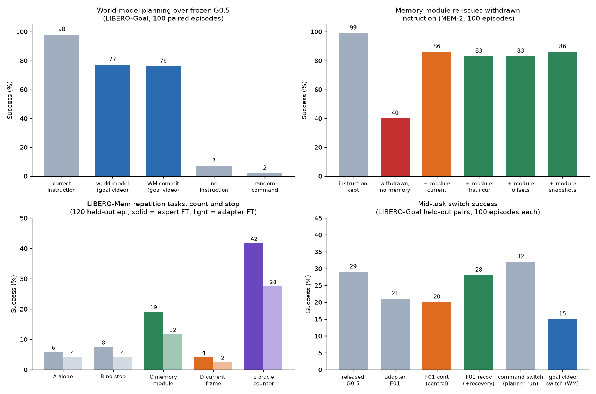

| Question | Answer | Key numbers |
|---|---|---|
| Can a small latent world model plan for a frozen VLA? | **Yes** | Goal video, no instruction: **77%** vs 2% (random command) and 7% (no instruction); p = 5e-23. World model: 43M. |
| Does memory help a VLA that only sees the current frame? | **Yes, as an external module** | Instruction removed: **40% → 86%**. LIBERO-Mem repetition tasks: **5.8% → 19.2%**; the same module without memory: 4.2%. |
| Can we make G0.5 more steerable? | **A little** | Recovery fine-tune: **20% → 28%** vs its matched control (p = 0.008). Released G0.5: 29%. A planner cannot add steerability. |
| Does feeding a pretrained world model's predictions into the policy help? | **No** | Staged training: **−7.5 pts** (p = 0.012). Joint training: no change. |
| Can an off-the-shelf embodied VLM (RoboBrain) be the high-level layer? | **Planner: partly. Memory / counter: no.** | Goal image → command: **42%** vs 24% for our world model with the same image (p = 0.005); world model with a subgoal video: 77%. As memory: 36% vs 40% without. As counter: 2.5% vs 5.8% without. |

---

## Contents

1. [Background papers](#1-background-papers)
2. [Directions and what we tested](#2-directions-and-what-we-tested)
3. [Setup](#3-setup)
4. [Protocol status](#4-protocol-status)
5. [Results](#5-results)
   - 5.1 [LaWAM's world model inside G0.5](#51-lawams-world-model-inside-g05)
   - 5.2 [Our small JEPA-style world model](#52-our-small-jepa-style-world-model)
   - 5.3 [Planning with the world model, closed loop](#53-planning-with-the-world-model-closed-loop)
   - 5.4 [Steerability](#54-steerability)
   - 5.5 [Memory](#55-memory)
   - 5.6 [3D-Mem snapshots](#56-3d-mem-snapshots)
   - 5.7 [RoboBrain as the high-level layer](#57-robobrain-as-the-high-level-layer)
6. [Transfer to our policy, data and robot](#6-transfer-to-our-policy-data-and-robot)
7. [Limitations](#7-limitations)
8. [Engineering notes and reproducibility](#8-engineering-notes-and-reproducibility)
9. [References](#9-references)

---

## 1. Background papers

| Paper | Main result | What we used |
|---|---|---|
| **RoboJEPA** (Zholus et al., 2026) [[1]](#ref1) | JEPA latent world model trained on real data from 12 robots, 22M → 8B parameters. Rollout error follows a power law in compute and **predicts planning success**. Zero-shot goal-image planning on real hardware. | Predict in **feature space, not pixels**. A small model is one point on a scaling curve. Use **offline rollout quality as a cheap check** before robot time. Plan toward goal images. |
| **FLARE** (Zheng et al., CoRL 2025) [[2]](#ref2) | Aligns a diffusion-transformer policy's internal features with embeddings of *future* frames, using a few extra tokens. Up to +26% on two multitask simulation benchmarks (single-arm, humanoid). Can co-train on action-free human video; one-demo generalisation to new objects. | Future prediction works best as a **training signal**, not as an extra input. Our §5.1 agrees. FLARE-style alignment on G0.5 is the next variant to try. |
| **LaWAM** (Chen et al., 2026) [[3]](#ref3) | Latent action model in frozen DINOv3 feature space. Its decoder is also a **latent world model** that predicts future features; the policy is conditioned on these latent subgoals. LIBERO 98.6%, RoboTwin 91.2%, real robot. 187 ms per chunk, up to 24× faster than pixel-space world-action models. | Its world model and checkpoint (`lawam_pretrain`), **transplanted into G0.5** (§5.1). Its DINOv3 feature space, which our own world model also predicts in (§5.2). |
| **3D-Mem** (Yang et al., CVPR 2025) [[4]](#ref4) | Scene memory as a compact set of **multi-view snapshots** (groups of objects seen together) plus frontier snapshots; built and searched step by step. Better exploration and embodied QA on A-EQA, GOAT-Bench and others. | **Event-driven snapshot memory**: write when the scene changes, read the first + recent snapshots. Tested inside G0.5 and as an external memory (§5.6). |
| **Pretrained VLAs resist forgetting** (Liu et al., ICML 2026) [[5]](#ref5) | Large pretrained VLAs (π0, GR00T N1.5) forget far less than small policies trained from scratch. **Experience replay** with a tiny buffer gives near-zero forgetting. Lost skills come back quickly with fine-tuning. | Our fine-tunes (steering recovery, LIBERO-Mem) replayed 10–50% original data; no significant loss of old skills (§5.4). Continual learning itself was not run. |

---

## 2. Directions and what we tested

"Markovian" below means the policy acts on the current frame only, with no memory.

| Supervisor direction | What we tested | Results |
|---|---|---|
| **Generalisation and steerability of low-level policies** | Probes: start in another task's scene, switch the command mid-task, remove the instruction, keep a stale instruction. Fix: fine-tune on recovery data. | §5.4 |
| **Small JEPA-style latent world models** | (a) LaWAM's pretrained world model inside G0.5. (b) Our own 3–43M action-conditioned world model on DINOv3 features. | §5.1, §5.2 |
| **Memory beyond Markovian VLAs** (plus ICL and continual learning) | (a) Memory adapters inside G0.5 (fixed offsets; 3D-Mem-style snapshots). (b) **External modules** that re-issue the task, or count progress and stop the robot. (c) The **LIBERO-Mem** benchmark. | §5.5, §5.6 |
| **Planning or training in a world model** | (a) Train G0.5 with world-model foresight (staged and joint). (b) **Plan at test time**: the world model scores G0.5's candidate action chunks against a goal. | §5.1, §5.3 |
| *(added)* **General high-level layer** | RoboBrain, zero-shot, as memory, counter and goal-image planner. | §5.7 |

---

## 3. Setup

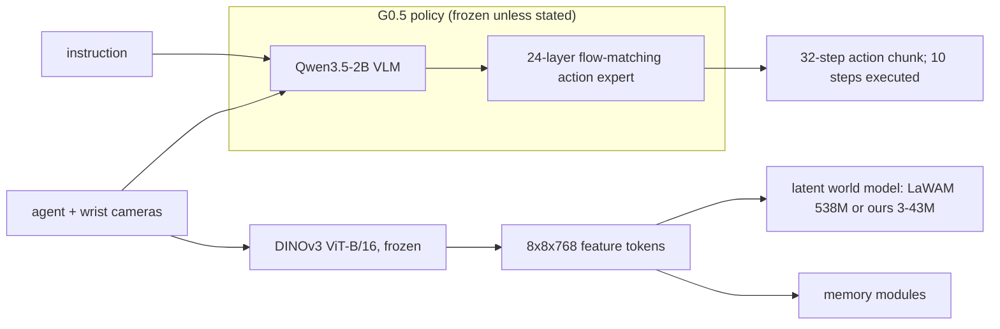

| Part | Details |
|---|---|
| **Policy** | Galaxea **G0.5**, released LIBERO checkpoint `g05-libero`, flow-matching mode. Qwen3.5-2B VLM + 24-layer action expert, ≈2.9B parameters. Paper: **98.9%** on LIBERO. Our reproduction: 99.2 / 99.8 / 98.2 / 98.4 on Spatial / Object / Goal / Long. |
| **LaWAM world model** | `jialei02/lawam_pretrain`, 538M. DINOv3 ViT-B/16 features, 32-d latent action, inverse-dynamics encoder, forward decoder. |
| **Our world model** | Transformer. Input: current pooled DINOv3 tokens + 8-step action chunk. Output: tokens 0.4 s ahead. Loss: 1-step + 2-step rollout. |
| **LIBERO** | 4 suites, 40 tasks. |
| **LIBERO-Goal probes** | 10 tasks in one shared scene, so the instruction is the only difference between tasks. Task pairs t ← s = t+3; events at 2 s; 100 paired episodes per cell. |
| **LIBERO-Mem** [[6]](#ref6) | 10 tasks that need history; 120 demos each; demos 100–119 held out. |
| **Compute** | Shared GPU cluster, 4×H200 allowance, fully booked for most of the project. G0.5 inference and training **ported to fp16 on T4/V100** (§8). The port matches the H200 numbers: ref 99 vs 98, withdrawal 40 vs 42, switch 31 vs 29. |
| **Statistics** | Every comparison is **paired** (same start states and seeds). Exact McNemar tests, or bootstrap CIs over episodes or tasks. |

---

## 4. Protocol status

Original protocol: "G0.5 FM + LaWAM, H200 protocol v2", 33 groups. ✅ done · ◐ partly done · ✗ not run.

| Group | Question | Status |
|---|---|---|
| B00 / B01 | Baselines: G0.5 on full LIBERO; LaWAM's own SFT model | ✅ B00 98.9%. ◐ B01: Long only (96.4%) |
| W00 / F00 | Does LaWAM predict LIBERO futures? Can G0.5's states drive it? | ✅ |
| F01–F03 | Feed current vs predicted features into G0.5; corruption controls | ✅ |
| J1–J3 | Joint world-model + policy training | ✅ |
| S02 / M02 | Steering and memory probes | ✅ all policies |
| S00 / S01 | Steerability fine-tune | ✅ recovery data + adapter fine-tune |
| SM1 / MEM-1 / MEM-2 | 3D-Mem-style memory; memory decoding; closed-loop memory module | ✅ |
| P00 / P01 | Planning in a world model | ✅ P01, offline and **closed loop** (our world model) |
| *(added)* LIBERO-Mem | Zero-shot, offline memory, closed-loop memory module | ✅ |
| *(added)* WM-1 / WM-MEM | World-model scaling and ablations; memory in the world model | ✅ |
| M00 / M01 / M03 | Minute-scale memory (10–900 s) | ✗ needs long-episode task suites (§6) |
| H00–H04 | High-level planner / verifier | ◐ zero-shot RoboBrain as memory, counter and goal-image planner (§5.7); VLM + world-model hierarchy not run |
| G00, I00, C00/C01, D00 | Generalisation (LIBERO-Plus/PRO), in-context learning, continual learning, data efficiency | ✗ out of time (D00 done for the world model only) |
| X01 / X02 | Real embodiment; memory revision | ✗ / ◐ (revision probes) |

---

## 5. Results

### 5.1 LaWAM's world model inside G0.5

**Setup**
- The LaWAM decoder predicts DINOv3 features 0.4 s ahead.
- A prior P maps G0.5's VLM states to LaWAM's latent action z.
- An adapter (resamplers + zero-init cross-attention) feeds features into action-expert layers 2, 5, …, 23. G0.5 stays frozen.
- Variants: F01 = current features; F02 = LaWAM-predicted future, staged training; J1 / J2 / J3 = joint training (detached / end-to-end / future dropout).
- Test: the 6 hardest tasks × 20 paired trials.

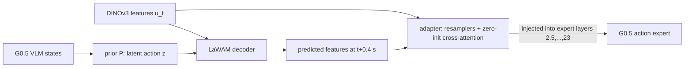

**World-model quality**

| Test | Result |
|---|---|
| W00: predict DINOv3 features 0.4 s ahead | **0.40× the error of persistence** ("nothing changes"); beats persistence on 100% of pairs |
| F00: driven by the prior on G0.5's VLM states | 0.69× persistence (oracle latent: 0.62×) |

**Policy success**

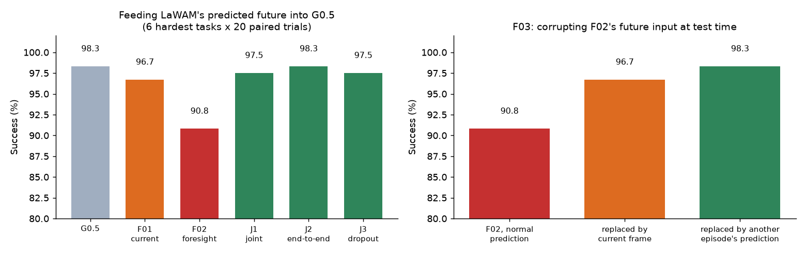

| Policy | Success | vs G0.5 |
|---|---|---|
| G0.5 | 98.3% | — |
| F01: adapter, current features | 96.7% | −1.7, n.s. |
| **F02: adapter, LaWAM-predicted future (staged)** | **90.8%** | **−7.5, p = 0.012** |
| J1 / J2 / J3: joint training | 97.5 / 98.3 / 97.5% | n.s.; +6.7 to +7.5 vs F02 |

**Analysis**
- The world model predicts well. The problem is how the policy uses the prediction.
- **The harm comes from the prediction's content.** At test time, swapping F02's prediction for another episode's brings success back to 98.3% (F03).
- **The policy trusts a well-timed prediction too much**, and that prediction drifts in closed loop.
- **Joint training removes the harm but adds nothing.** LIBERO is at a 98% ceiling.
- **Every adapter variant also lowers steerability** (§5.4).
- **Conclusion:** do not feed a pretrained world model's output into a strong VLA as an extra input. Use it as a training signal (FLARE-style), or next to the policy as a critic or planner (§5.3).

### 5.2 Our small JEPA-style world model

**Setup**
- Input: current DINOv3 tokens (pooled to 8×8) + an 8-step action chunk. Output: tokens 0.4 s ahead. Longer horizons by rollout.
- Loss: 1-step + 2-step rollout. Training: a few hours on one GPU.
- Test: held-out episodes.
- Metric: prediction error ÷ error of persistence ("nothing changes"). Lower is better; 1.0 = no better than persistence.

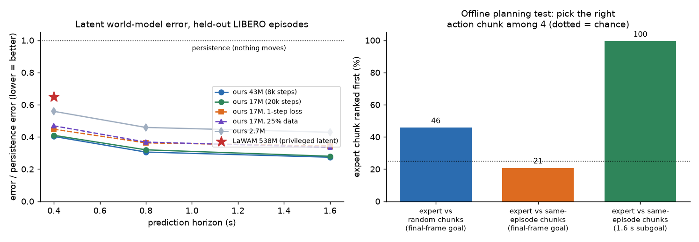

**Prediction error**

| Model | Parameters | Error ÷ persistence at 0.4 / 0.8 / 1.6 s |
|---|---|---|
| Ours, 20k steps | 17M | **0.41 / 0.32 / 0.28** |
| Ours, 8k steps | 43M | **0.40 / 0.31 / 0.27** |
| Ours, 8k steps | 2.7M | 0.56 / 0.46 / 0.43 |
| LaWAM (privileged posterior latent), same 8×8 grid | 538M | 0.65 at 0.4 s |

**Analysis**
- **Beats LaWAM's 538M model in-domain:** 0.40 vs 0.65 at 0.4 s.
- **Bigger is better:** 2.7M → 17M → 43M improves every horizon.
- **The multi-step loss helps long rollouts:** 0.317 vs 0.344 at 1.6 s (17M, 8k steps, with vs without the 2-step term).
- **Data-efficient:** 25% of the training data gives about 6% more error.
- **It uses the actions:** shuffled actions give 2.35× the error.
- **History does not help it:** adding 0.8–4 s of history improves error by 0.4%. Given the actions, LIBERO physics depends only on the current state.

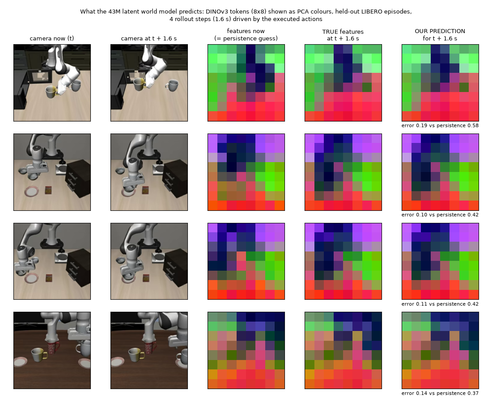

*Each row: the current and future camera frames, then the DINOv3 tokens as PCA colours for the current frame, the true 1.6 s future, and our 4-step prediction. The prediction follows the true future; "nothing changes" does not.*

**Offline planning test** (world-model figure, right panel). The world model ranks 4 candidate chunks by how close each predicted future is to the goal. Chance = 25%.

| The other 3 candidates | Goal | Expert chunk ranked first |
|---|---|---|
| Chunks from other episodes | Final frame | 46% |
| Look-alike chunks from the same episode | Subgoal 1.6 s ahead | **99.5%** |
| Look-alike chunks from the same episode | Final frame | 21% |

**Analysis**
- With a near subgoal, the world model almost always finds the right chunk.
- With only a far goal, chunks that skip ahead look closer to it, so greedy ranking fails.
- **The planner needs near-term subgoals.**

### 5.3 Planning with the world model, closed loop

**Setup**
- Task: LIBERO-Goal, 10 tasks × 10 paired trials.
- Input: **no instruction**, only a goal video (demo features of the target task, indexed by time).
- Policy: frozen G0.5. Planner: our 43M world model.

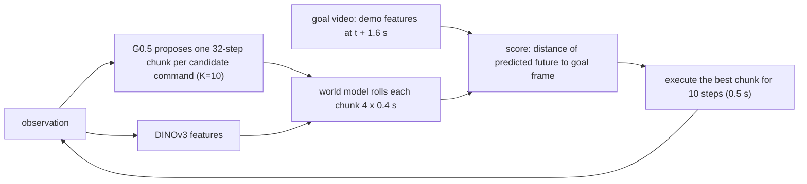

**Results**

| Planner | Success | vs random |
|---|---|---|
| Correct instruction (upper bound) | 98% | — |
| **World model, chooses every 0.5 s** | **77%** | **+75 pts, p = 5e-23** |
| **World model, commits after 1.5 s** | **76%** | **+74 pts, p = 2e-20** |
| Random command every 0.5 s | 2% | — |
| No instruction | 7% | — |

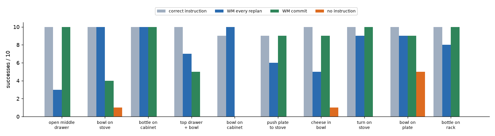

<table>
<tr><td align="center"><b>No instruction (left) vs world-model planner (right)</b> target task: "turn on the stove"</td>
<td align="center"><b>World-model planner on three tasks</b> bowl on stove · bottle on cabinet · turn on stove</td></tr>
<tr><td>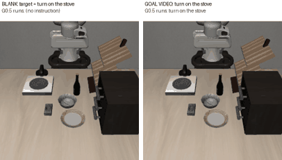</td><td>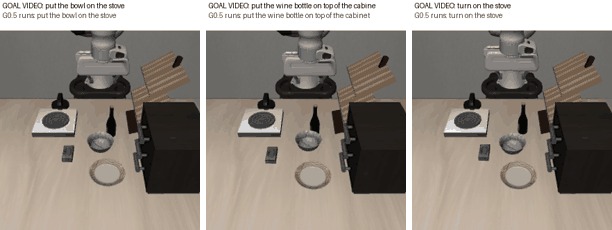</td></tr>
</table>

**Analysis**
- **It picks moves that make progress, not task labels.** It picks the target's own command only 32–60% of the time, yet succeeds 77%, because commands share early motions.
- **The two variants fail on different tasks**, so combining them could help.
- **Final goal image only: fails** (0/5 pilot). The subgoal matters.
- **It cannot re-steer G0.5.** Goal video switched at 2 s: **15%** with the planner vs **32%** by switching the command. After a switch, *every* G0.5 proposal still heads to the old object, so there is no good chunk to pick.

### 5.4 Steerability

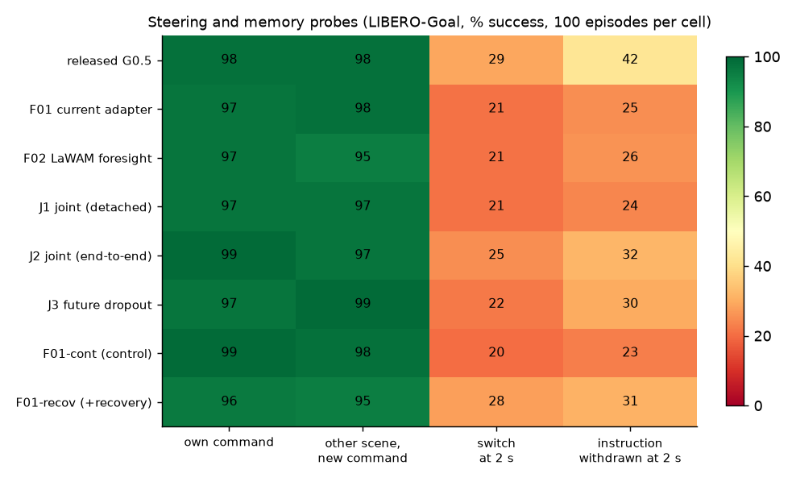

**Probes on released G0.5** (LIBERO-Goal)

| Probe | Success |
|---|---|
| Own command | 98% |
| Started in another task's scene | 98% |
| **Command switch at 2 s** | **29%** (7 of 10 pairs: 0/10) |
| Instruction removed at 2 s | 42% |
| Stale instruction | 20% |

**Recovery fine-tune (S00/S01-style)**
1. Recorded 145 successful post-switch episodes, on *training* pairs only.
2. Fine-tuned the adapter on 50% recovery + 50% original data (replay, as in [[5]](#ref5)).
3. Control: an identical run without recovery data.

| | Own command | Other scene | **Switch** | Withdrawn |
|---|---|---|---|---|
| Released G0.5 | 98 | 98 | 29 | 42 |
| Matched control (F01-cont) | 99 | 98 | 20 | 23 |
| **Recovery fine-tune (F01-recov)** | 96 | 95 | **28** (+8 vs control, p = 0.008, 8 wins / 0 losses) | 31 |

<b>Released G0.5 after a command switch: does not switch (left) vs switches (right)</b> 
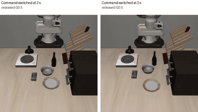

**Analysis**
- **G0.5 follows the first command well but rarely re-steers.**
- **Recovery data helps:** +8 pts vs its matched control.
- **Replay kept old skills:** own-command and other-scene stayed within noise.
- **The gain only cancels the adapter's own loss** (control 20% vs released 29%). Beating released G0.5 needs more recovery data (DAgger rounds) and a full fine-tune.
- **Steerability must come from the policy.** A planner cannot add it (§5.3).

### 5.5 Memory

#### A. Re-issue a removed instruction (MEM-2)

**Setup**
- LIBERO-Goal, 100 paired episodes. The instruction is removed at 2 s.
- The module stores DINOv3 features of every frame. At 2 s, a 3M task decoder (trained on human demos) names the task from selected frames, and the text goes back into G0.5's prompt.

**Results**

| Condition | Success | Task recognised correctly |
|---|---|---|
| Instruction kept (ceiling) | 99% | — |
| Instruction removed at 2 s, no memory | **40%** | — |
| + module, current frame only | **86%** | 87% |
| + module, fixed offsets / first frame | 83% / 83% | 85% / 84% |
| + module, 3D-Mem-style snapshots | **86%** | **90%** |

<b>Instruction removed at 2 s: G0.5 alone (left) vs with the memory module (right)</b> 
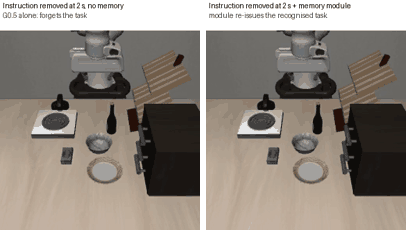

**Analysis**
- p ≈ 1e-10 vs no memory. The module recovers about 75% of the 59 lost points.
- **This is mostly recognition, not memory.** In this shared scene the current frame already shows the task (the arm moves toward the target object). The current-frame module scores 86%, the same as the best memory variant.
- **It does not help after a command revision.** G0.5 keeps doing the old task, so the history shows the old task.

#### B. Tasks that need history: LIBERO-Mem

**Zero-shot G0.5**
- Does a single pick-and-place; cannot repeat, swap or rotate.
- 0/120 on those tasks; 19% average subgoal completion. The paper reports π0 at 5%.

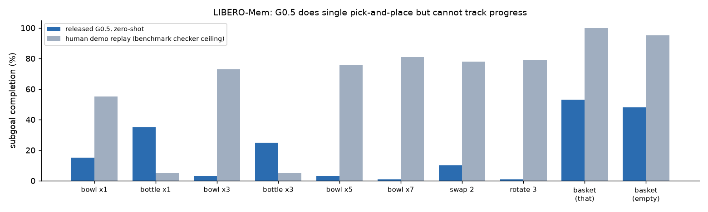

**Offline: does memory carry the missing state?** (held-out demos)

| Test | Current frame | With memory |
|---|---|---|
| Count finished pick-and-place cycles (repetition tasks, after cycle 1) | 15% | **72%** with whole-episode memory (+57 pts, CI [+51, +63]) |
| Task identification on LIBERO-Spatial (two identical bowls): error | 2.9% | ~0% |

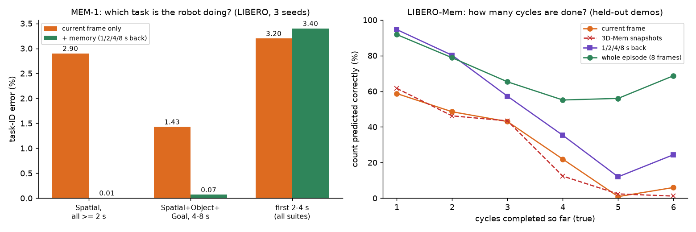

**Closed loop: fine-tuned G0.5 + a module that counts and stops**

- Policy: G0.5 fine-tuned on LIBERO-Mem demos 0–99, either the action expert (635M parameters, on a V100) or an adapter only.
- Test: 6 repetition tasks × 20 held-out start states.
- Full-length episodes: success is the benchmark's overshoot-aware check at the end, so extra cycles count as failure.

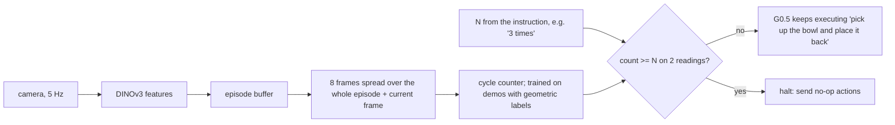

| Condition | Expert fine-tune | Adapter fine-tune |
|---|---|---|
| A. Fine-tuned G0.5 alone | 5.8% | 4.2% |
| B. Single-cycle instruction, never stops | 7.5% | 4.2% |
| **C. + memory module (whole-episode counter)** | **19.2%** | **11.7%** |
| D. + current-frame counter (no memory) | 4.2% | 2.5% |
| E. + perfect counter (upper bound) | 41.7% | 27.5% |

Paired McNemar tests, expert fine-tune: **C vs A: p = 0.003** · **C vs D: p = 5e-4** · C vs E: p = 1e-6.

<b>"Place the bowl back ONCE": fine-tuned G0.5 alone overshoots (left); the memory module stops it (right)</b> 
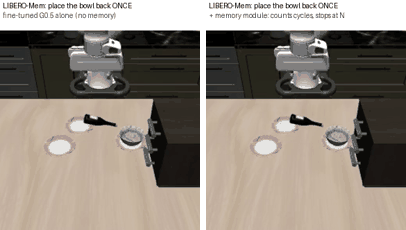

**Analysis**
- **Fine-tuned G0.5 does the cycles but cannot stop:** 59% of subgoals done, 6% success. This is the Markovian failure.
- **The whole-episode counter triples success:** 5.8% → 19.2%.
- **The gain comes from memory:** the same module reading only the current frame gives no gain (D: 4.2%).
- **Large headroom:** a perfect counter reaches 41.7%. The learned counter mostly miscounts at 5–7 repetitions.

### 5.6 3D-Mem snapshots

**Setup** (3D-Mem's snapshot rule, adapted to manipulation)
- Write: a new snapshot when the DINOv3 features change past a threshold (about 10 per episode).
- Read: the first snapshot + the 3 most recent.

| Test | Snapshot memory | Best alternative |
|---|---|---|
| Inside G0.5 (memory adapter, offline loss) | no gain (0.0405) | no memory variant helped (0.0404) |
| MEM-1 task identification | 98.2% | fixed offsets 98.5% |
| MEM-2 closed loop | **86%, tied best; best recognition (90%)** | current frame 86% |
| LIBERO-Mem cycle counting | **13.6%, no gain** | whole-episode sampling **71.9%** |

**Analysis**
- "First + 3 recent" fits 3D-Mem's purpose: remembering *what a place contains*.
- Counting and progress need one memory of **each finished event**, all the way back. The middle events are never read, so counting fails.
- **Next step: event-indexed snapshots.** Write one at every finished sub-step and keep them all. The memory then *is* the progress state, and stays small for minutes-long episodes.

### 5.7 RoboBrain as the high-level layer

**Setup**
- Why: our memory modules and planner use LIBERO-specific parts (classifiers trained on LIBERO demos, a fixed list of LIBERO commands, demo goal videos). A general embodied VLM would remove them.
- Model: **RoboBrain** (BAAI [[8]](#ref8)), Qwen-VL based, trained for embodied pointing, planning and video reasoning. Outputs text, points and trajectories; no actions.
- Run **zero-shot** in three roles, on its own GPU next to the G0.5 server.

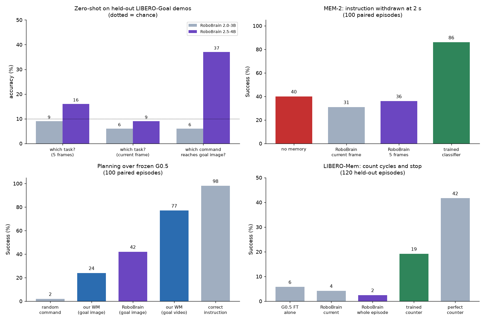

**Offline, held-out LIBERO-Goal demos** (chance 10%)

| Question | RoboBrain 2.0-3B | RoboBrain 2.5-4B |
|---|---|---|
| Which task is the robot doing? (5 frames over 2 s) | 9% | 16% |
| Same, current frame only | 6% | 9% |
| Which command reaches this goal image? | 6% | **37%** |

- 2.0-3B describes a frame as "a table with a black and white square box, a round object…": no robot arm, stove or cabinet.
- Prompt format (numbers, letters, free text), resolution and precision (fp16 vs fp32) do not change this.

**Closed loop** (RoboBrain 2.5-4B, paired with the earlier runs)

| Role | Without | **RoboBrain** | Task-trained module | Notes |
|---|---|---|---|---|
| MEM-2 memory: instruction removed at 2 s, re-issue the task | 40% (no memory) | 36% (5 frames); 31% (current frame) | **86%** (trained classifier) | Names the right task only 18% of the time; wrong reminders hurt (current frame vs none: p = 0.05) |
| LIBERO-Mem counter: count cycles, stop at N | 5.8% (fine-tuned G0.5 alone) | 2.5% (whole episode); 4.2% (current frame) | **19.2%** (trained counter) | Answers "1" at the start of single-repeat tasks (stops at once); never reaches 5–7 |
| **Planner from a single goal image** | 2% (random command) | **42%** (re-chosen every 2 s) | 24%: our world model with the **same** goal image | RoboBrain vs world model: **p = 0.005**. World model with a goal *video*: **77%** (p = 5e-6 vs RoboBrain). |

**Analysis**
- **Zero-shot, RoboBrain does not see LIBERO scenes well enough** to replace a trained memory or counter. Here, a trained perception module beats general reasoning.
- **It helps with choosing a goal.** From a single far goal image it beats greedy world-model matching (42% vs 24%). Reasoning about "which instruction leads to this end state" beats feature distance to a far goal.
- **The two fit together.** The world model needs near-term subgoals; the VLM is good at picking goals. Next experiment: **VLM proposes the sub-goal or command → world model checks near-term chunks → G0.5 executes.**
- **Real data should be easier for it.** RoboBrain was trained on real and egocentric images. Test it on our robot's camera before ruling it out.

---

## 6. Transfer to our policy, data and robot

| Component | Shown in sim | To use with our policy and data | On the real robot | Main risks |
|---|---|---|---|---|
| **Small latent world model** | 43M model, hours to train, beats LaWAM in-domain; 99.5% chunk ranking with near-term subgoals | 1. Cache frozen DINOv3 features of our robot's demos (e.g. r1_vr). 2. Train the same model on our action space. 3. Deploy only if it passes the offline ranking test (RoboJEPA: rollout error predicts planning). | About 1 ms per rollout; feature extraction is the main cost | Real scenes vary far more; a small model will underfit, so scale it or fine-tune LaWAM/RoboJEPA as the backbone. 8×8 pooling may miss small contacts. |
| **World-model planning** | Frozen G0.5 + world model: 77% from a goal video | Candidates need not be a task list: **sample K chunks from G0.5 with different noise seeds** (best-of-K / MPC), or let a VLM propose sub-instructions | Goals: a user goal image + **subgoals** from a high-level planner or demo keyframes. Latency: K proposals batched (K=4–8 at 2 Hz on one H200). | Needs near-term subgoals; cannot create behaviours the policy never proposes. Best uses: reliability (pick the best sample), safety (reject predicted failures), image goals. |
| **Memory module, re-prompting (A)** | 40% → 86% when the instruction is lost | Replace the closed-set task classifier with a **VLM reading episode keyframes** that writes the current sub-instruction (open vocabulary) | Supervisor at about 1 Hz over the VLA. Useful after interruptions, in multi-step jobs ("cup already in the sink, now wipe the table"), and for tasks given by demonstration. | VLM latency and errors; a wrong reminder is worse than none (task 8 lost trials). |
| **Memory module, progress / count / stop (B)** | 5.8% → 19.2% on LIBERO-Mem; a current-frame control gives no gain | Progress labels from gripper + object events (as here) or VLM annotation of demo segments. **Event-indexed snapshot memory** for minute-scale tasks. | Counting and completion: "stir 3 times", "fasten 4 screws", "place N items" | The learned counter gets ~40% of a perfect counter's gain; needs better event detection (object-centric tracking or a VLM). |
| **Steerability** | G0.5 switches 29%; recovery data +8 pts vs control | Collect recovery and intervention data on our robot (teleop corrections, DAgger rounds). **Full fine-tune with a small replay buffer** ([[5]](#ref5): limits forgetting). Test with switch probes + LIBERO-PRO-style language changes. | Mid-task corrections from an operator or a high-level planner | Needs far more recovery data than 145 episodes; adapter-only fine-tunes cap the gain. |
| **Embodied VLM as high-level layer (RoboBrain)** | Goal image → command: 42% (our world model with the same image: 24%). Zero-shot memory or counting: no gain. | Use it to **choose goals and sub-instructions**; let the world model check near-term chunks. Fine-tune on a few hundred labelled frames of our scenes before using it as memory. | The real camera is closer to its training data than LIBERO renders | Latency (0.1–0.5 s per query on T4); weak perception of small or unusual objects |
| **Continual learning** | Not run; the replay setting kept old skills | Experience replay with small buffers when adding skills ([[5]](#ref5)) | — | Verify on our own task sequence. |

**Next steps, by value per compute:**
1. **World-model critic on our data.** Train the 43M world model on our robot data; run best-of-K sampling with G0.5 in our simulator or on offline replays.
2. **Event-indexed memory.** Run it on LIBERO-Mem, then on a minute-scale suite built from chained LIBERO tasks (M00/M01).
3. **Full G0.5 fine-tunes on H200**, for steering recovery (more data) and LIBERO-Mem, with the startup team's training optimisations (≈50–55 windows/s).
4. **VLM + world-model hierarchy (H00).** A VLM (e.g. RoboBrain, fine-tuned on a few hundred frames of our scenes) proposes the command or subgoal, the world model checks G0.5's near-term chunks, G0.5 executes. §5.7: the VLM is better at choosing goals, the world model at near-term matching.

---

## 7. Limitations

- **Simulation only (LIBERO).** No real-robot or real-data experiments yet.
- **In-domain comparison.** Our world model beats LaWAM *on LIBERO only*. LaWAM is general-purpose and was run off its native resolution and horizon.
- **Planner goal source.** The goal video comes from demos of the same task and scene. A real deployment needs a goal image plus generated subgoals.
- **MEM-2 is mostly recognition.** On LIBERO-Goal, the current-frame module matches the memory variants.
- **LIBERO-Mem's checker is unreliable on bottle tasks.** It fails 95% of human-demo replays there, so those tasks are near zero for every method.
- **Hardware.** Most closed-loop runs used the fp16 T4/V100 port, checked against H200 numbers. Fine-tunes were small (2–3k steps, batch 16) because the H200s were busy.
- **Single seeds for closed-loop policy fine-tunes.** The offline memory results use 3 seeds.

---

## 8. Engineering notes and reproducibility

**Issues found and fixed**

| Issue | Effect | Fix |
|---|---|---|
| LaWAM's LIBERO dataset stores the gripper with the opposite sign to G0.5 | Frozen G0.5 loss 2.44 instead of 0.07; a first adapter "learned" to undo it | Converted the dataset with `a6 → 1 − a6` |
| MuJoCo EGL aborts on some H200 nodes | Evaluation suites crashed | Exclude those nodes; per-task clients with retry |
| G0.5 eval client over-counts when `num_parallel > num_trials` | Impossible success counts | Cap parallelism at the number of trials |
| G0.5 on T4/V100: no bf16; FlashAttention needs sm80+; this torch build has no sm70 kernels | Crashes or out-of-memory | fp16 autocast mapping (`t4_fp16.py`), SDPA fallbacks, input-dtype hooks, LaWM offload, separate cu126 venv for Volta |
| Mixed-source training batches miss metadata keys | Collate errors | Recursive key fill in `07b_train_lmem.py` |

**External pieces** (not in this repo):
- [GalaxeaVLA](https://github.com/OpenGalaxea/GalaxeaVLA) with the `g05-libero` checkpoint
- [LaWAM](https://github.com/RLinf/LaWAM) with `jialei02/lawam_pretrain`
- DINOv3 ViT-B/16 (gated)
- LIBERO and LaWAM's merged LIBERO dataset (gripper sign fixed with `jobs/13_convert_gripper.py`)
- the [LIBERO-Mem](https://github.com/libero-mem/libero-mem) fork and raw demos
- RoboBrain 2.0-3B / 2.5-4B (gated)

**Running:** all scripts source `env_g05.sh`, which sets `G05_ROOT` and the paths. Scripts are SLURM jobs, numbered roughly in run order. Generated `results/` and `logs/` are not tracked.

**Repository layout** (paths relative to `G05_ROOT`):

| Item | Path |
|---|---|
| Full results log | [`RESULTS.md`](RESULTS.md); `results/closed_loop_summary.json` (from `jobs/53_closed_loop_summary.py`) |
| Hybrid (LaWAM in G0.5) | `jobs/lawam_hybrid.py`, `07_train_hybrid.py`, `08_eval_screen.sh`, `results/hybrid/*` |
| Our world model | `jobs/23_train_wm.py`, `35_train_wm_mem.py`, `results/wm_*`, `results/wmmem_*` |
| World-model planner | `jobs/49_wm_planner.py`, `50_wm_planner.sh`, `results/wmplan/*` |
| Steering probes and recovery | `jobs/18_libero_steer_client.py`, `19_steer_mem.sh`, `25_collect_recovery.sh`, `results/steer/*`, `results/recovery/` |
| Memory (MEM-1/2) | `jobs/29_mem_intent.py`, `31_mem2.sh`, `results/mem_intent/`, `results/mem2/` |
| LIBERO-Mem | `libero_mem/` (fork + raw demos), `jobs/43–48, 51, 52, 54`, `results/lmem_*` |
| T4/V100 port | `jobs/t4_fp16.py`, `serve_policy_hybrid.py`, `07b_train_lmem.py`, `GalaxeaVLA/.venv_sm70` |
| Figures and demo media | `media/` (from `media/make_figs.py`; GIFs from `jobs/56_demos.sh`, `57_demo_gifs.py`, `58_compare_gifs.py`) |

---

## 9. References

[1] A. Zholus et al. **RoboJEPA: Scaling Robotic Latent World Models.** arXiv:2610.10515, 2026. [paper](https://arxiv.org/abs/2610.10515) · [code](https://github.com/facebookresearch/robo_jepa)

[2] R. Zheng et al. **FLARE: Robot Learning with Implicit World Modeling.** CoRL 2025, arXiv:2505.15659. [paper](https://arxiv.org/abs/2505.15659)

[3] J. Chen et al. **LaWAM: Latent World Action Models for Efficient Dynamics-Aware Robot Policies.** arXiv:2606.15768, 2026. [paper](https://arxiv.org/abs/2606.15768) · checkpoint `jialei02/lawam_pretrain`

[4] Y. Yang et al. **3D-Mem: 3D Scene Memory for Embodied Exploration and Reasoning.** CVPR 2025, arXiv:2411.17735. [paper](https://openaccess.thecvf.com/content/CVPR2025/html/Yang_3D-Mem_3D_Scene_Memory_for_Embodied_Exploration_and_Reasoning_CVPR_2025_paper.html)

[5] H. Liu, C. Kim, B. Liu, M. Liu, Y. Zhu. **Pretrained Vision-Language-Action Models are Surprisingly Resistant to Forgetting in Continual Learning.** ICML 2026, arXiv:2603.03818. [paper](https://arxiv.org/abs/2603.03818)

[6] Chung et al. **LIBERO-Mem / Rethinking Progression of Memory State in Robotic Manipulation: An Object-Centric Perspective.** arXiv:2511.11478. [paper](https://arxiv.org/abs/2511.11478) · [code](https://github.com/libero-mem/libero-mem)

[8] BAAI. **RoboBrain 2.0 / 2.5.** arXiv:2507.02029. [model](https://huggingface.co/BAAI/RoboBrain2.0-3B) · [code](https://github.com/FlagOpen/RoboBrain2.0)

[7] Galaxea **G0.5** ([GalaxeaVLA](https://github.com/OpenGalaxea/GalaxeaVLA)) · B. Liu et al. **LIBERO** benchmark.
